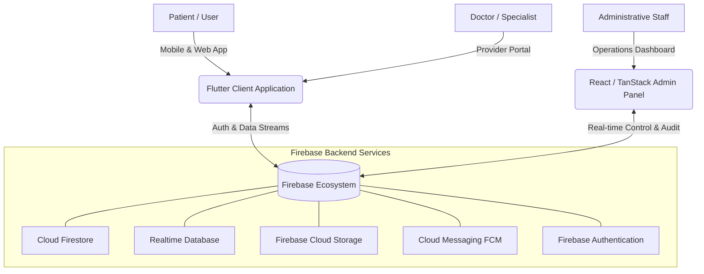

# O2 Clinic - Enterprise Digital Healthcare Ecosystem 🏥

[](https://flutter.dev/)
[](https://dart.dev/)
[](https://firebase.google.com/)
[](https://react.dev/)
[](https://www.typescriptlang.org/)
[](#license)

---

## 🌟 Executive Summary

**O2 Clinic** is an enterprise-grade digital healthcare management ecosystem engineered to bridge patients, medical specialists, and clinic operations into a unified, high-reliability platform. 

The system couples a **Flutter-powered cross-platform mobile & web client** for patients and doctors with a high-performance **React / TypeScript TanStack administrative control portal** for full clinic lifecycle operations.

---

## 🏗️ System Architecture & Platform Suite



---

## ⚡ Core Capabilities & Clinical Modules

### 1. 🧑‍⚕️ Specialized Clinical Appointments
* **Multi-Disciplinary Booking:** Direct booking for specialized clinical departments, medical consultations, and board-certified doctors.
* **Dual-Mode Healthcare Delivery:** Seamless support for in-clinic physical appointments and high-definition online telemedicine consultations.
* **Dynamic Slot Engine:** Intelligent doctor schedule tracking with slot conflict prevention and real-time buffer management.

### 2. 🩻 Intelligent Radiology & Diagnostic Pricing Center
* **Prescription & Scan Ingestion:** Patients securely upload radiology prescriptions, MRI/CT scans, and diagnostic lab requests.
* **Direct Price Inquiries:** Integrated negotiation and real-time quoting channel connecting patients directly with radiology department administrators.
* **Automated Status Workflow:** Smooth transition from `pending_price` to `confirmed` with instant push notifications.

### 3. 🔬 Medical Devices & Equipment Catalog
* **Interactive Catalog:** Comprehensive directory of medical devices, specs, and therapeutic equipment available at O2 Clinic.
* **Contextual Chat Linking:** Instant quote and purchase inquiries linked automatically to specific device units with rich preview cards.

### 4. 💬 Real-Time Unified Medical Support Chat
* **Multi-Stream Messaging:** Dedicated channels for general customer care, medical device inquiries, and diagnostic pricing.
* **Rich Media Collaboration:** High-speed streaming of text, images, video demonstrations, voice notes, and PDF medical reports.
* **Real-time Delivery:** Sub-second sync leveraging Firestore & RTDB listeners with unread counters and badge triggers.

### 5. 🖥️ Executive Administrative Control Panel
* **Operational Command Dashboard:** Real-time revenue metrics, daily appointment tallies, upcoming visit indicators, and active patient volume.
* **Patient & Doctor Directories:** Granular user lifecycle management, block/active statuses, and credential verification.
* **Financial & Audit Logs:** Transaction tracking, discount code lifecycle, and auditable operator logs for compliance.

---

## 🌐 Enterprise Internationalization (i18n)

Engineered for global deployment with native bidirectional support:

| Language | Code | Direction | Support Status |
| :--- | :---: | :---: | :---: |
| **English** | `en` | LTR | Fully Supported |
| **العربية (Arabic)** | `ar` | RTL | Fully Supported (Native) |
| **עברית (Hebrew)** | `he` | RTL | Fully Supported (Native) |

---

## 🛠️ Technology Stack

### Mobile & Patient Client (Flutter)
* **Framework:** [Flutter 3.x](https://flutter.dev/) (Channel Stable)
* **Language:** [Dart 3.x](https://dart.dev/)
* **State Management & DI:** [GetX Architecture](https://pub.dev/packages/get)
* **Networking & Data:** Cloud Firestore, Firebase Realtime Database, HTTP Client
* **Media & Audio:** `just_audio`, `record`, `cached_network_image`, `video_player`
* **Maps & Geolocation:** `google_maps_flutter`, `geolocator`
* **Local Notifications:** `firebase_messaging`, `flutter_local_notifications`

### Operations Control Portal (Admin Panel)
* **Core:** [React 18](https://react.dev/) + [TypeScript](https://www.typescriptlang.org/) + [Vite](https://vitejs.dev/)
* **Routing:** [TanStack Router](https://tanstack.com/router)
* **UI Design System:** Radix UI primitives, TailwindCSS styling tokens, Lucide Icons, Glassmorphism design language
* **Data Layer:** Firebase Client SDK (Firestore listeners + RTDB bindings)

---

## 📂 Repository Directory Structure

```text
o2_clinic/
├── android/                         # Native Android configuration & Gradle builds
├── ios/                             # Native iOS Runner & CocoaPods workspace
├── web/                             # Flutter Web deployment artifacts
├── lib/
│   ├── common/                      # Enterprise UI kit (Buttons, Inputs, Dialogs, Shimmers)
│   ├── core/                        # System foundation (Theme tokens, Colors, Routes, Enums)
│   ├── features/                    # Domain-Driven Functional Modules
│   │   ├── appointments/            # Patient visit history, active schedules, and status tracking
│   │   ├── auth/                    # Multi-role authentication (Patient, Doctor, Admin)
│   │   ├── booking/                 # Scheduling pipelines (Clinical, Radiology, Cosmetic, Direct)
│   │   ├── chat_support/            # Live chat pipelines (Customer Support, Radiology, Devices)
│   │   ├── dashboard/               # Main navigation, medical banners, and quick-action hubs
│   │   ├── doctors/                 # Specialist profiles, availability slots, and ratings
│   │   ├── notifications/           # Push notification handler and action dispatcher
│   │   └── profile/                 # Patient health records, settings, and legal policies
│   ├── firebase_options.dart        # Auto-generated Firebase multi-platform configuration
│   └── main.dart                    # Application bootstrap & dependency injection root
├── pubspec.yaml                     # Application dependencies, assets, and versioning
└── README.md                        # Enterprise project documentation
```

---

## 🚀 Deployment & Local Setup

### Prerequisites
* **Flutter SDK:** `>= 3.10.4`
* **Dart SDK:** `>= 3.0.0`
* **Node.js:** `>= 18.x` (for Admin Panel)
* **Android Studio / Xcode:** For mobile compilation

### 1. Clone the Repository
```bash
git clone https://github.com/MahmoudAshraf19/o2-clinic.git
cd o2-clinic
```

### 2. Configure Flutter Mobile Client
```bash
# Navigate to the mobile application root
cd o2_clinic

# Fetch dependencies
flutter pub get

# Run on connected device or simulator
flutter run
```

### 3. Production Compilation
```bash
# Compile Android Release APK / Bundle
flutter build apk --release
flutter build appbundle --release

# Compile Web Release
flutter build web --release
```

---

## 🔒 Security, Compliance & Data Governance

* **Authentication Guardrails:** Role-based access control (RBAC) enforced via Firebase Authentication & Security Rules.
* **Audit Trail:** Critical administrative operations (price modifications, booking status updates, credential revocations) are immutably logged.
* **Encrypted Storage:** Sensitive patient diagnostic uploads are restricted with Firebase Cloud Storage security policies.

---

## 📄 License & Attribution

This software is developed and maintained for **O2 Clinic Healthcare Services**. All rights reserved. 
Unauthorized duplication, distribution, or commercial exploitation without explicit authorization is strictly prohibited.

---

<p align="center">
  <b>O2 Clinic</b> • Advancing Digital Healthcare with Precision & Empathy.
</p>
